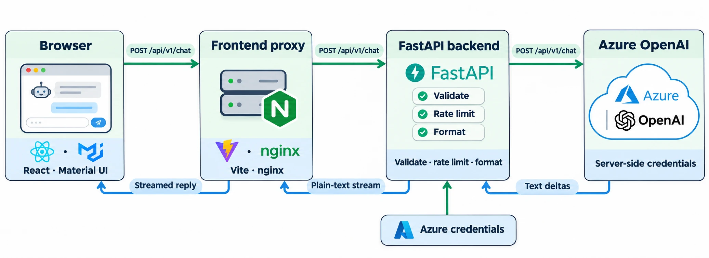
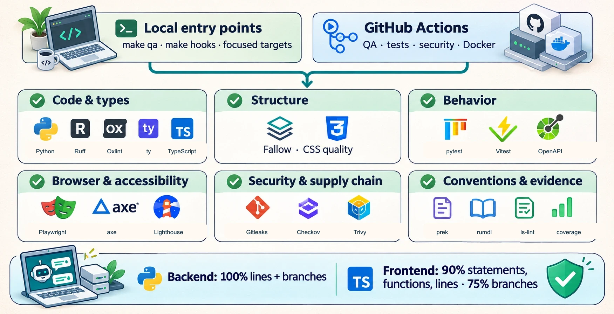

# Documentation illustrations

These illustrations summarize the request path and quality gates. Technical
details remain in the linked documentation and are the source of truth. Editable
SVG files compose the diagrams; WebP files are the published versions.

## Chatbot architecture



- **Files:** `docs/images/chatbot-template-architecture.svg` and
  `docs/images/chatbot-template-architecture.webp`
- **Content:** The browser sends `POST /api/v1/chat` through the frontend proxy.
  FastAPI forwards the request to Azure OpenAI for a streaming completion.
  Text deltas return through FastAPI, the proxy, and the browser. Azure
  credentials remain on the server.
- **Image prompt:**

  ```text
  Use case: ui-mockup
  Asset type: small decorative illustration inside a technical architecture diagram
  Primary request: Draw a friendly browser chat window as a compact editorial illustration. Show a simple browser frame with a tiny friendly assistant robot, two pale message bubbles, and a send control.
  Style/medium: refined flat vector art, rounded shapes, fine navy outlines, soft sky-blue and pale green surfaces, subtle depth, crisp and calm.
  Composition/framing: centered object, front view, square transparent canvas, clear silhouette with even padding.
  Text (verbatim): none.
  Constraints: no product marks, no brand logos, no readable text, no watermark; keep the artwork useful at 180 by 130 pixels.
  ```

- **Logo files:** React, Material UI, Vite, nginx, and FastAPI marks are local
  SVG files under `docs/images/icons/`, sourced from Simple Icons.

## Quality harness



- **Files:** `docs/images/chatbot-template-quality-harness.svg` and
  `docs/images/chatbot-template-quality-harness.webp`
- **Content:** Local entry points (`make qa`, `make hooks`, and focused targets)
  and GitHub Actions feed six groups of checks: code and types; structure;
  behavior; browser and accessibility; security and supply chain; conventions
  and review evidence. Backend coverage is 100% for lines and branches.
  Frontend coverage is at least 90% for statements, functions, and lines, and
  75% for branches.
- **Image prompt:**

  ```text
  Use case: productivity-visual
  Asset type: small decorative illustration inside a software quality overview
  Primary request: Draw a cheerful engineering workstation for software quality: a laptop with abstract code glyphs, a compact server stack, and a simple shield with a checkmark.
  Style/medium: refined flat vector editorial art, soft green, blue and warm neutral colors, tidy navy outlines, light depth, calm and approachable.
  Composition/framing: compact centered group, three-quarter view, square transparent canvas with even padding, visible as a 200-pixel wide accent.
  Text (verbatim): none.
  Constraints: no brand marks or recognizable product logos, no readable words, no watermark; do not add extra characters or decorative rays.
  ```

- **Logo files:** GitHub Actions, Docker, and Python marks are local SVG files
  under `docs/images/icons/`, sourced from Simple Icons.

## Logo sources

| Mark           | Source                                                           |
| -------------- | ---------------------------------------------------------------- |
| Docker         | [Simple Icons](https://cdn.simpleicons.org/docker/2496ED)        |
| FastAPI        | [Simple Icons](https://cdn.simpleicons.org/fastapi/009688)       |
| GitHub Actions | [Simple Icons](https://cdn.simpleicons.org/githubactions/2088FF) |
| Material UI    | [Simple Icons](https://cdn.simpleicons.org/mui/007FFF)           |
| nginx          | [Simple Icons](https://cdn.simpleicons.org/nginx/009639)         |
| Python         | [Simple Icons](https://cdn.simpleicons.org/python/3776AB)        |
| React          | [Simple Icons](https://cdn.simpleicons.org/react/61DAFB)         |
| Vite           | [Simple Icons](https://cdn.simpleicons.org/vite/646CFF)          |

Simple Icons is distributed under [CC0 1.0](https://github.com/simple-icons/simple-icons/blob/develop/LICENSE.md).
